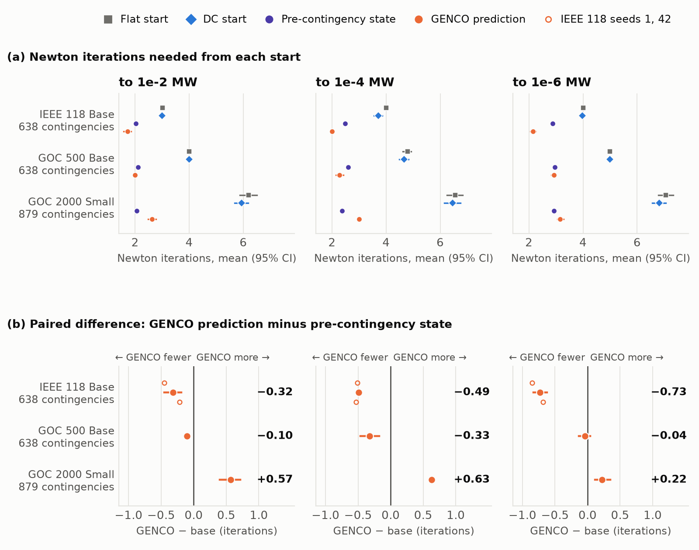
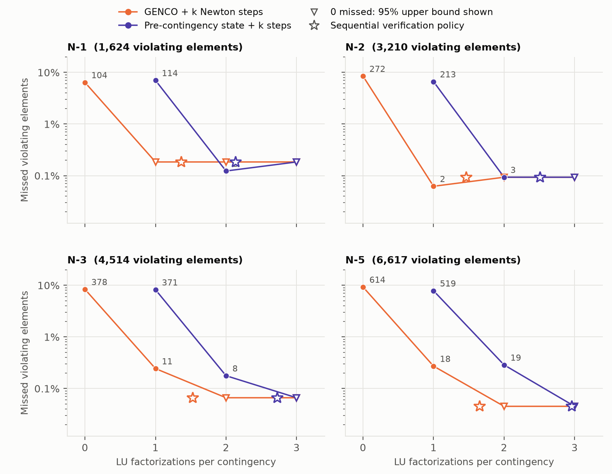

# What is GENCO worth to a Newton solver? Pricing a grid foundation model against the pre-contingency state

Entry to the GridFM GENCO Challenge 2026, by Muhammad Sarwar. Write-up: [docs/POST.md](docs/POST.md). Models and data: {{LINKS}}.

GENCO predicts an AC power-flow state in one forward pass. In contingency analysis, though, an operator rarely solves from scratch: the solved pre-contingency case is already on the screen and is the warm start production tools use. This repository asks a narrow question about the released GENCO checkpoints. If the prediction is handed to a float64 Newton solver, how much solver work does it save against the pre-contingency start, and can that saving be taken without missing an overload? Everything here, from the Newton solvers to the figure scripts, is built to answer that and to let you re-check it. Every number in the write-up is traced to a source file in [docs/NUMBERS.md](docs/NUMBERS.md).

## Results at a glance

On IEEE 118, starting Newton from GENCO instead of the pre-contingency state saves 0.49 [0.45, 0.53] iterations to 10⁻⁴ MW at N-1 and about one iteration at N-5. A screening rule that verifies each contingency with Newton steps and a calibrated error bound needs 18–44% fewer factorizations from GENCO's start. It missed no overload in 429 held-out operating points (one-sided 95% bound 0.7%). The advantage shrinks with grid size: 0.33 iterations at 500 buses, and at 2,000 buses the pre-contingency start is better by 0.63. On a laptop, inference costs 14× to 580× more than the solver work it saves.

Two further findings. First, GENCO's PF task treats the slack-bus voltage magnitude as an unknown although it is a setpoint, which makes the reported power balance 32–60× better than the physical one on IEEE 14–118. Second, a residual decoder that starts exactly at the pre-contingency state (GENCO-Δ) cuts N-1 state error 2.5×, but saves Newton work only at a loose tolerance and regresses at N-5.

These numbers come from the write-up and are traced to result files in [docs/NUMBERS.md](docs/NUMBERS.md).



*Newton iterations from flat, DC, pre-contingency and GENCO starts (left) and the paired GENCO minus pre-contingency difference (right), with 95% cluster-bootstrap intervals over load scenarios.*



*Missed violations against factorizations per contingency on IEEE 118 (four 100-load-scenario test sets). Hollow markers are zero-miss cells, drawn at their one-sided 95% Clopper–Pearson bound.*

The remaining figures (workflow, factor-reuse break-even, slack audit, GENCO-Δ) are in [results/figures/post/](results/figures/post/), with the plotted values next to each one in `data/`.

## What is in this repo

- `src/genco_certified/`: the installable package.
  - `acpf.py` is the float64 AC power flow on exactly the admittance graph GENCO sees.
  - `fastpf.py` holds the chord and fast-decoupled solvers that reuse one factorization per operating point.
  - `tracing.py` captures GENCO's state after each correction layer.
  - `graphkit_plugin.py` is the slack-aware PF task for gridfm-graphkit.
  - `basecase_store.py` and `genco_residual.py` are the pre-contingency store and the residual GENCO-Δ decoder.
  - `loading.py` builds a task and test dataloader in-process.
- `scripts/`, one per experiment:
  - `reproduce.py` and `summarize_repro.py` re-evaluate the released checkpoints.
  - `exp01_layers_newton.py` (layer dynamics, Newton from each layer) and `exp06_slack_audit.py` (slack convention).
  - `exp02_screening.py` with `analyze_exp02.py` (exchange rate, sequential policy, calibration, confidence intervals).
  - `exp05_best_start.py` and `exp07_industrial_baselines.py` (best-of-two start, chord and fast-decoupled baselines, timing).
  - `exp04_embedding_probe.py` and `exp08_bias_correction.py` (two negative results).
  - `finetune.py`, `finetune_residual.py` and the `run_genco_delta*.sh` drivers (slack-aware fine-tune, GENCO-Δ).
  - `make_post_figures.py`, `build_space_bundle.py`, `verify_artifacts.py`, and the `run_batch3*.sh` drivers.
- `configs/datakit/`: the gridfm-datakit configs for every new scenario set (N-1 to N-5, calibration, exhaustive).
- `space/`: a small Gradio console that walks one contingency through the policy. It is prepared but not published.
- `notebooks/`: two Colab notebooks for a GPU timing run and for GENCO-Δ on GOC 2000. See `notebooks/README.md`.
- `tests/`: unit tests for the solvers, the screening policy and the GENCO-Δ code.
- `results/`: JSON, CSV and logs for every table, one directory per experiment (`exp01` to `exp08`, `genco_delta`, `repro`, `runtime`), and `figures/post/`. `SHA256SUMS` covers the tracked files.
- `docs/`: `POST.md` (write-up), `NUMBERS.md` (source of truth for every number), `REPRODUCE.md` (commands), `report.md` (earlier report, see its header).

## Reproduce

The reference machine is a MacBook Air M4 with Python 3.12. A full run needs about 25 GB of disk; the core reproduction needs about 8 GB.

```bash
./scripts/setup_env.sh && source .venv/bin/activate && pip install -e .
python scripts/fetch_data.py --task pf --partitions 30
python scripts/reproduce.py --task pf --sizes base small tiny
python scripts/exp02_screening.py --grid case118_ieee --size base
python scripts/analyze_exp02.py --v3 && python scripts/analyze_exp02.py --ci
python scripts/make_post_figures.py
python -m pytest -m "not data" -q
python scripts/verify_artifacts.py
```

The last command checks `SHA256SUMS`, that every result JSON parses, and that its numbers are finite; add `--checkpoints` to also match the released weights. Data generation for the stress sets, the GOC runs, fine-tuning and GENCO-Δ are in [docs/REPRODUCE.md](docs/REPRODUCE.md). Counts of iterations and factorizations reproduce to the printed precision on the same platform; timings and the last digits of mismatches will vary by machine.

## Negative results

- Convergence rescue: flat-start Newton never failed up to N-5, so there was nothing to rescue.
- Accepting GENCO with no Newton step: its own residual never certified a whole contingency.
- The embedding probe ("the latents know where GENCO is wrong") is withdrawn; bus identity alone explains about as much.
- Per-bus bias correction removes 0.3% of squared error in-sample and nothing out of sample.
- Slack fix by mask surgery on Base: feeding the setpoint in multiplies state error by 17×; re-anchoring voltages is worse in 95–100% of scenarios.
- Slack-aware fine-tune: honest power balance, about 29% worse state error than a matched control, no iteration gain.
- Plain GENCO-Δ reaches base-case quality at best; one seed diverged. Residual GENCO-Δ regresses at N-5.
- Calibrating the error bound on 29 operating points was not exchangeable across outage order (up to 33% exceedance at N-2). A 100-point calibration fixes it, without making it a guarantee.
- Plain chord Newton from the base case fails the 50-iteration cap in 20–70% of contingencies, depending on outage order.
- No wall-clock gain on an M4 laptop: inference is 12–1,600× above break-even.

## Limitations

The zero-miss result is empirical, on datakit scenarios. Calibration and test sets share datakit's daily load trajectory, so the operating-point bounds are optimistic, and a Newton–Kantorovich certificate that would give a proof does not hold at GENCO's raw output. Factor-reuse results cover IEEE 118 and GOC 500 at seed 0; GENCO-Δ was run on IEEE 118 only. The reproduction of the released checkpoints uses about 3% of each paper test set, with mean metrics within about 6% (worst 13%). Timings come from Python and SciPy, and a compiled solver would push the break-even lower. GPU timings have not been measured yet.

## License and attribution

Apache-2.0 ([LICENSE](LICENSE)). [NOTICE](NOTICE) lists the third-party software, models and data this work builds on, with their terms: gridfm-graphkit, gridfm-datakit and the released GENCO checkpoints. To cite, use [CITATION.cff](CITATION.cff).

Contact: Muhammad Sarwar, msarwar@iastate.edu
