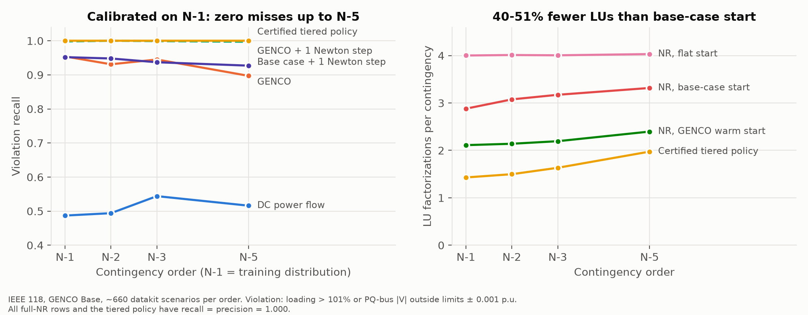

# GENCO, Certified

This repository is our entry to the [GridFM GENCO Challenge 2026](https://huggingface.co/spaces/gridfm/genco-challenge). It studies the power-flow (PF) variant of GENCO [1], the GridFM grid foundation model, from two angles:
- how the model arrives at its answer;
- when that answer can be trusted for contingency screening.

The short version: GENCO's output makes an excellent starting point for a single Newton–Raphson step. That step turns a learned prediction into an AC power flow that can be checked, and it tells you how far off the prediction was.

By "certified" we mean something specific and modest. Every screening decision we accept has been checked against the AC power-flow equations after a Newton step, using an error bound calibrated on held-out data. It is an empirical guarantee, not a formal proof.

The full write-up is in [docs/report.md](docs/report.md). Every number below, and every assumption behind it, is traced in [RESEARCH_LOG.md](RESEARCH_LOG.md).

## 1. Main results

All results use the released GENCO checkpoints and the OpenGridFM toolkits (gridfm-graphkit, gridfm-datakit [2]). Unless stated otherwise, the grid is IEEE 118 with the Base model.

**Reproduction.** We re-evaluated 20 released checkpoints on the authors' own held-out test scenarios. The mean PF metrics agree with the published values to within 6% on most runs, and OPF on IEEE 57/118 to within 8%.

**Inside GENCO.**
- Over its 12 correction layers, GENCO roughly halves its own power mismatch per layer, much like a linearly convergent iterative solver.
- Stopping after layer 9 saves about a quarter of the inference time and costs less than 0.1 extra Newton iteration downstream.
- A linear probe on the final-layer embeddings predicts where the voltage-magnitude errors are (R² = 0.63). The local power mismatch alone gives 0.24.

**A masked setpoint.** The PF mask in gridfm-graphkit asks GENCO to predict the slack-bus voltage magnitude, even though it is a dispatch setpoint the operator already knows.
- GENCO's power balance holds at its own guess of that value.
- With the true setpoint imposed, the largest nodal mismatch is 26 to 60 times larger than the reported one.
- The error is local: the worst bus sits next to the slack bus in 98 to 100% of scenarios, and the rest of the state is accurate.
- Another entrant (another entry) also treats this voltage as known in its own adapter. Our contribution here is the measurement and the fix attempt.

**Newton-verified contingency screening.** We screen for thermal overloads above 101% of rating and for PQ-bus voltages outside their limits. The escalation rule was calibrated on N-1 contingencies only.

TABLE I. Screening on IEEE 118: violation recall and sparse LU factorizations per contingency

| Contingencies (count) | DC power flow | Base case + 1 Newton step | GENCO + Newton, calibrated escalation | Newton from base case | Newton from flat start |
|---|---|---|---|---|---|
| N-1 (660) | 0.49 | 0.95 | 1.00 at 1.43 LU | 1.00 at 2.88 LU | 1.00 at 4.00 LU |
| N-2 (659) | 0.49 | 0.95 | 1.00 at 1.50 LU | 1.00 at 3.08 LU | 1.00 at 4.01 LU |
| N-3 (660) | 0.54 | 0.94 | 1.00 at 1.63 LU | 1.00 at 3.17 LU | 1.00 at 4.01 LU |
| N-5 (660) | 0.52 | 0.93 | 1.00 at 1.97 LU | 1.00 at 3.32 LU | 1.00 at 4.03 LU |

The GENCO-based screen raised no false alarms on any of these sets. It used 40 to 51% fewer factorizations than Newton warm-started from the pre-contingency solution, which is the usual practice in contingency analysis.

<p align="center"></p>
<p align="center"><em>Fig. 1. Calibrated on N-1, tested on N-1 to N-5. Left: violation recall. Right: factorizations per contingency.</em></p>

**What did not work, or did not generalize.**
- At 2,000 buses (GOC 2000, released Small checkpoint), the pre-contingency base case is a better Newton starting point than GENCO: 2.95 against 3.23 iterations on average. A simple selector compares the power mismatch at both candidates and costs nothing extra. It matches the base case there and keeps most of GENCO's advantage on IEEE 118.
- We fine-tuned a variant that receives the slack voltage as an input. It removed the hidden mismatch, but it was about 25% less accurate than a matched control at the training budget we could afford on a laptop.
- On an Apple M4 laptop, a lean sparse Newton solver is faster than GENCO inference at both 118 and 2,000 buses. For that reason, all cost figures here are in factorizations, and the report gives the break-even condition rather than a speedup claim.

## 2. Reproducing the results

Requirements: Python 3.12 (gridfm-graphkit does not support 3.13+), [uv](https://docs.astral.sh/uv/), git, and roughly 6 GB of disk. No GPU is needed. Everything was run on a MacBook Air (M4).

```bash
./scripts/setup_env.sh                 # pinned gridfm-graphkit 8a8defb, gridfm-datakit d8a092d, .venv
source .venv/bin/activate
pip install -e .                       # this package (genco_certified) and its graphkit plugin
gridfm_datakit setup_pm                # Julia + PowerModels + Ipopt, once (~2 min)

./scripts/run_all.sh                   # data subsets, reproduction, all experiments, figures (~2 h)
./scripts/run_all.sh --with-finetune   # adds the slack-aware fine-tune and its control (~80 min more)
python -m pytest -q tests
```

Three practical notes:
- The full datakit test sets are large (3 to 170 GB per grid). `scripts/fetch_data.py` downloads only the first few partitions. It then intersects them with the authors' published `scenario_splits.json`, so every evaluation uses the paper's own held-out scenarios.
- Graphkit's OPF baseline fails under pandas 3, so the environment pins `pandas<3`.
- The stress sets (N-1 to N-5) are generated with gridfm-datakit from `configs/datakit/`. These configs copy the dataset's original `args.log` and change only the number of outages.

## 3. Repository layout

```
src/genco_certified/   tracing hooks, float64 Newton-Raphson on GENCO's network,
                       base-case reconstruction from datakit data, graphkit plugin
scripts/               data fetch, reproduction, experiments 01-05, figures, run_all.sh
configs/datakit/       stress-test generation configs
docs/report.md         technical report
space/                 Gradio operator console (runs GENCO live on a 5 MB scenario bundle)
results/               logs, summaries and figures (large intermediates are regenerated)
tests/                 unit tests for the AC power-flow code
RESEARCH_LOG.md        dated record of findings, assumptions and corrections
```

The `genco_certified` package is small on purpose:
- `tracing.py` records GENCO's intermediate states with forward hooks instead of re-implementing the model.
- `acpf.py` rebuilds the admittance matrix from exactly the edge features GENCO consumes. At the ground truth the mismatch is below 4·10⁻³ MW, and a flat-start Newton solve reproduces datakit's solution to 2·10⁻⁷.
- `graphkit_plugin.py` registers a `PowerFlowSlackAware` task through graphkit's plugin mechanism.

## 4. Limitations

- The escalation bound is calibrated on data, not derived. Zero missed violations holds on about 2,600 IEEE-118 contingencies and is not a guarantee.
- The GOC 2000 results rest on one released checkpoint and 198 leak-free held-out scenarios.
- The fine-tuning comparison uses about 2% of the original training data and a single seed per arm.
- Base-case states are reconstructed from datakit's topology variants. Each element takes its majority status across the variants of a load scenario.

## References

[1] GENCO, arXiv:2608.09921, 2026.
[2] gridfm-datakit, arXiv:2512.14658, 2025.
[3] H. F. Hamann et al., "Foundation models for the electric grid," *Joule*, 2024, arXiv:2407.09434.
